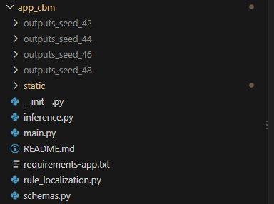

# Neuro-Symbolic Vietnamese Cultural Classifier — CBM

Nhánh `cbm` tập trung vào pipeline **Baseline + Concept Bottleneck Model
(CBM) + trích xuất luật + GFlowNet + rule regularization**. Notebook Kaggle
dual-GPU dùng template
[cbm-neuro-symbolic-kaggle-template.ipynb](./cbm-neuro-symbolic-kaggle-template.ipynb).
API inference CBM nằm trong [app_cbm/](./app_cbm/).

## Cài đặt

Yêu cầu Python 3.10 trở lên. Cài dependencies trong môi trường phù hợp với
phiên bản PyTorch/CUDA của máy:

```powershell
python -m pip install -r requirements.txt
```

Trước khi chạy, cập nhật `data_dir` và `cbm.concept_annotations_path` trong
[params.yaml](./params.yaml). Dataset cần có các thư mục `train`, `val`,
`test` và `val2`, mỗi thư mục chứa thư mục con theo lớp.

## Huấn luyện

Chạy một lượt pipeline trên thiết bị khả dụng:

```powershell
python -m pipelines.run_cbm_neuro_symbolic_pipeline --config params.yaml
```

Chạy song song hai seed trên hai GPU (ví dụ Kaggle GPU T4 x2):

```powershell
python -m pipelines.run_dual_gpu_cbm_experiment --config params.yaml --seeds 42 44
```

Mỗi seed ghi kết quả vào `outputs_seed_<seed>/`. Có thể bỏ qua baseline đã
được huấn luyện bằng `--skip-baseline`. Cấu hình và đường dẫn đầu ra có thể
điều chỉnh trong `params.yaml`; kết quả training history được lưu cùng các
checkpoint và báo cáo trong thư mục output.

## Luật từ image_concept (GFlowNet xây luật)

Luồng mới thay cho việc GFlowNet chỉ *chọn* luật từ cây quyết định: GFlowNet *xây* luật
trực tiếp trên nhãn concept của từng ảnh, dạng `(áo dài ∧ chùa) ⇒ khmer`, có cả literal
phủ định (`¬nón lá`).

```bash
# 1. Sinh tập luật từ image_concepts (chỉ đọc nhãn concept, không cần RF)
python -m pipelines.stage4_concept_rules_gflownet --config params.yaml
#    -> outputs/04c_concept_rules/{concept_rules.txt, selected_rules.pkl, concept_rules_report.json}

# 2a. Dùng luật làm regularizer cho CBM (như cũ, chỉ đổi nguồn luật)
python -m pipelines.stage5_train_rule_regularized --target cbm --rules-dir 04c_concept_rules

# 2b. Dùng luật như một KHỐI MỚI trong CBM: logit += ConceptRuleHead(concept_probs)
#     đặt rule_penalty.mode: "head" (hoặc "both" để kết hợp với penalty) trong params.yaml
```

Các thành phần chính:

- `src/gflownet/concept_rule_env.py` — DAG xây luật: thêm literal → chọn vế phải → exit.
  Ràng buộc: không có cả `k+` lẫn `k-`, không thêm literal sau vế phải, số literal ≤ `max_literals`.
- `src/gflownet/concept_rule_reward.py` — reward của một luật: precision (m-estimate về tần
  suất lớp), recall lớp, phạt độ dài, phạt phủ quá ít. Nhãn NaN (ignore) không khớp literal nào.
- `src/gflownet/concept_rule_pipeline.py` — vòng huấn luyện TB/DB, archive ứng viên, và
  `select_rule_set` chọn tập luật theo *xung đột đo theo mẫu* (không theo cặp luật).
- `src/models/rule_head.py` — `ConceptRuleHead` (khởi tạo 0, nên CBM không đổi khi mới gắn)
  và `RuleAugmentedCBM`.

Luật được xuất dưới dạng `Rule` với `feature_index` = chỉ số concept, nên `VectorizedRulePenalty`
và `ConceptRuleHead` dùng chung được mà không sửa.

Lưu ý khi dùng:

- Reward chỉ học từ `concept_rules.source_split` (mặc định `train`). Val/test chỉ được báo cáo
  trong `concept_rules_report.json`, không dùng để chọn luật.
- Ảnh không có nhãn concept riêng bị loại khỏi reward (`use_class_prototype: false`), vì prototype
  lớp là nhãn suy ra và sẽ khiến luật chỉ học lại chính prototype.
- `rule_lr` của khối luật cần đủ lớn (mặc định `1e-3`): trọng số khởi tạo 0 và LR head chung
  (`1e-4`) sẽ rất chậm.
- Checkpoint của mode `head`/`both` có khóa `rule_head.*`. `app_cbm` và `evaluate_saved_checkpoints`
  chưa biết khóa này nên cần cập nhật nếu muốn phục vụ mô hình có khối luật.

## Chạy notebook trên Kaggle

Mở notebook template ở trên, bật GPU (khuyến nghị GPU T4 x2), cập nhật
`GIT_BRANCH`, dataset và file concept annotations nếu cần, rồi chạy các cell
theo thứ tự. Notebook cài dependencies cần thiết và chạy cùng pipeline CBM
trên nhánh này.

## Chạy API inference
Tải output(file zip trong output) theo seed của mô hình muốn chạy , giải nén vào app_cbm/



Sau khi có artifacts, cài dependencies của ứng dụng và khởi động API:

```powershell
python -m pip install -r requirements.txt -r app_cbm/requirements-app.txt
uvicorn app_cbm.main:app --host 0.0.0.0 --port 8000 --reload
```

Mở `http://localhost:8000` để dùng giao diện hoặc `/docs` để xem API. Hướng
dẫn chuẩn bị artifacts chi tiết nằm trong [app_cbm/README.md](./app_cbm/README.md).

## Kiểm thử

```powershell
pytest tests/ -v
```
